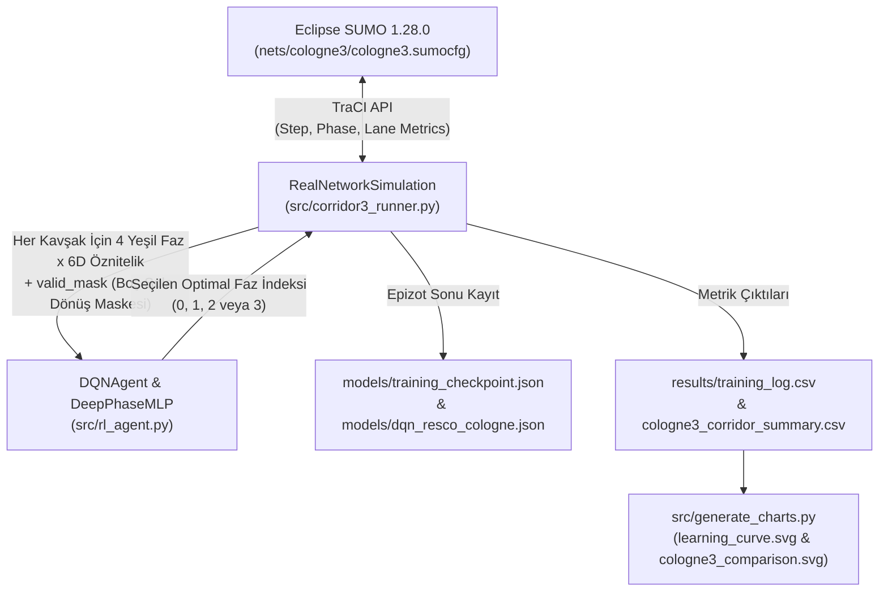

# ARCHITECTURE.md — Sistem Mimarisi ve Kod Tabanı Analizi

Bu doküman, **`adaptive-traffic-signal-rl`** (*Simulation-Based Intelligent Traffic Management System Using Deep Reinforcement Learning*) projesinin mevcut dizin yapısını, bağımlılıklarını, veri akışını ve gerçek kod tabanındaki modülleri hiçbir varsayımda bulunmadan, doğrudan mevcut kaynak kodları baz alarak belgeler.

---

## 1. Teknoloji Yığını ve Çalışma Ortamı (Tech Stack & Runtime)

Proje, harici ağır derin öğrenme kütüphanelerine (CUDA/PyTorch derleme bağımlılıklarına) ihtiyaç duymadan, **Python 3.14+** üzerinde sıfır-bağımlılıklı (pure-Python) sinir ağı motoru ve **Eclipse SUMO 1.28.0+** mikroskobik trafik simülatörü ile çalışacak şekilde tasarlanmıştır.

| Katman | Teknoloji / Kütüphane | Mevcut Kullanım Yeri ve Rolü |
| :--- | :--- | :--- |
| **Trafik Simülatörü** | **Eclipse SUMO 1.28.0** (`sumo.exe`, `sumo-gui.exe`) | Varsayılan kurulum yolu: `C:\Program Files (x86)\SUMO`. Gerçek Köln yol ağını ve araç fiziğini (Krauss car-following, HBEFA3 $\text{CO}_2$ emisyon modeli) koşturur. |
| **Simülasyon Köprüsü** | **`traci`** (SUMO Python API) | `SUMO_HOME/tools` üzerinden dinamik olarak `sys.path`'e eklenir. Kavşak topolojisi keşfi, şerit kuyruk/bekleme/emisyon okuma ve trafik ışığı faz kontrolü sağlar. |
| **Derin RL Motoru** | **Pure-Python `DeepPhaseMLP` & `DQNAgent`** (`src/rl_agent.py`) | Standart kütüphaneler (`math`, `random`, `json`, `collections.deque`) kullanılarak sıfırdan gerçeklenmiş 3 katmanlı (`6 -> 64 -> 64 -> 1`) Faz-Rekabetli Derin Q-Ağı. |
| **Veri İşleme & Çıktı** | `csv`, `json`, `xml.etree.ElementTree`, `lxml` | `tripinfo.xml` ayrıştırma, eğitim logları (`results/*.csv`), model ağırlık kaydı (`models/*.json`) ve vektörel grafik (`results/*.svg`) üretimi. |
| **Dokümantasyon Üretimi** | `python-docx>=1.1.0` | `docs/generate_midterm_report.py` ve `docs/generate_brief_pdf.py` içinde resmi `.docx` ve `.pdf` raporlarının otomatik inşası. |
| **Python Yorumlayıcısı** | **Python 3.14.4 (AMD64)** | Yerel yürütülebilir yol: `C:\Users\besir_secilmis\AppData\Local\Python\bin\python.exe`. |

---

## 2. Klasör ve Dosya Düzeni (Directory Tree)

```text
traffic-rl/
├── ARCHITECTURE.md                              # Sistem mimarisi ve modül analizi (Bu dosya)
├── RULES.md                                     # Mevcut kodu korumak için uyulması gereken kurallar
├── PLAN.md                                      # Vize sonrası Final aşaması geliştirme yol haritası
├── README.md                                    # Proje genel tanıtım dosyası
├── requirements.txt                             # Python paket bağımlılıkları (lxml, python-docx, requests vb.)
├── .gitignore                                   # Git hariç tutma kuralları (__pycache__, *.tripinfo.xml vb.)
│
├── 1_Mod_Sabit_Sureli_3Kavsak_Izle.bat          # [Aktif] Cologne-3 Fixed-Time modunu SUMO-GUI'de başlatır
├── 2_Mod_Sensorlu_Actuated_3Kavsak_Izle.bat     # [Aktif] Cologne-3 Actuated modunu SUMO-GUI'de başlatır
├── 3_Mod_Akilli_RL_DQN_3Kavsak_Izle.bat         # [Aktif] Cologne-3 Eğitilmiş DQN modunu SUMO-GUI'de başlatır
├── 4_Tum_Modlari_Hizli_Karsilastir_Tablo.bat    # [Aktif] 3 modu headless koşturup karşılaştırma tablosu basar
├── 5_Egitimi_Baslat_veya_Devam_Et.bat           # [Aktif] Checkpoint destekli 50 epizot DQN eğitimini başlatır/sürdürür
├── 6_Egitimi_Sifirla_Bastan_Baslat.bat          # [Aktif] Checkpoint'i silip eğitimi 1. bölümden başlatır
├── run_gui_demo.bat                             # [Eski/Prototip] Tekil kavşak demo başlatıcısı
│
├── src/                                         # Kaynak kod dizini
│   ├── rl_agent.py                              # [AKTİF ÇEKİRDEK] DeepPhaseMLP (6->64->64->1) ve DQNAgent sınıfı
│   ├── corridor3_runner.py                      # [AKTİF ÇEKİRDEK] RealNetworkSimulation, 4 fazlı kontrol, eğitim ve benchmark
│   ├── generate_charts.py                       # [AKTİF YARDIMCI] CSV sonuçlarından SVG grafiklerini üreten betik
│   ├── env.py                                   # [ESKİ PROTOTİP] Sentetik tekil kavşak (TL_C1) 2 fazlı ortam sınıfı
│   ├── baselines.py                             # [ESKİ PROTOTİP] env.py ile çalışan 2 fazlı sabit/actuated/max-pressure
│   ├── evaluate.py                              # [ESKİ PROTOTİP] env.py tabanlı eski değerlendirme betiği
│   ├── demo_gui.py                              # [ESKİ PROTOTİP] env.py tabanlı eski GUI betiği
│   └── build_networks.py                        # [ESKİ PROTOTİP - ÇALIŞTIRILMAMALI] Sentetik XML üreteci (Gerçek haritayı ezer!)
│
├── nets/                                        # Gerçek Dünya NeurIPS 2021 RESCO SUMO Haritaları
│   ├── cologne3/                                # [AKTİF ANA AĞ] Köln-Lindenthal Dürener Str. 3 kavşaklı koridor
│   │   ├── cologne3.net.xml                     # Gerçek Köln yol ağı ve sinyal faz mantıkları (149 KB)
│   │   ├── cologne3.rou.xml                     # Gerçek sabah zirve saati (25200s-28800s) araç rotaları (763 KB)
│   │   ├── cologne3.sumocfg                     # SUMO simülasyon yapılandırması (begin=25200, end=28800)
│   │   └── gui-settings.xml                     # SUMO-GUI görsel şema ("real world") ayarları
│   └── cologne1/                                # [İKİNCİL GERÇEK AĞ] Köln Dürener Str. & Universitätsstr. tekil kavşak
│       ├── cologne1.net.xml                     # Gerçek tekil kavşak yol ağı (38 KB)
│       ├── cologne1.rou.xml                     # Gerçek araç talebi (182 KB)
│       ├── cologne1.sumocfg                     # SUMO yapılandırması (begin=25200, end=28800)
│       └── gui-settings.xml                     # SUMO-GUI görünüm ayarları
│
├── models/                                      # Eğitilmiş Sinir Ağı Ağırlıkları ve Checkpoint Dosyaları
│   ├── dqn_resco_cologne.json                   # [AKTİF MODEL] Cologne-3 üzerinde 50 epizot eğitilmiş en iyi ağırlıklar (134 KB)
│   ├── training_checkpoint.json                 # [AKTİF CHECKPOINT] 50/50 epizot eğitim durumu, q_net, target_net, best_net (442 KB)
│   └── dqn_cologne1.json                        # [ESKİ MODEL] İlk prototip aşamasından kalan ağırlık dosyası (10 KB)
│
├── results/                                     # Deneysel Çıktılar, CSV Tabloları ve SVG Grafikler
│   ├── training_log.csv                         # [AKTİF] 50 epizotluk Cologne-3 eğitim geçmişi
│   ├── cologne3_corridor_summary.csv            # [AKTİF] Cologne-3 üzerinde 3 modun (Fixed, Actuated, DQN) resmi sonuçları
│   ├── learning_curve.svg                       # [AKTİF] 50 epizotluk bekleme süresi yakınsama grafiği
│   ├── cologne3_comparison.svg                  # [AKTİF] 3 modlu performans karşılaştırma sütun grafiği
│   ├── benchmark_comparison.svg                 # cologne3_comparison.svg ile senkronize grafik kopyası
│   ├── benchmark_summary.csv                    # [ESKİ] İlk prototip özet tablosu
│   └── benchmark_detailed_seeds.csv             # [ESKİ] İlk prototip çoklu tohum tablosu
│
└── docs/                                        # Akademik Raporlar ve Brifing Dokümanları
    ├── MCBU_Midterm_Report.docx                 # Resmi MCBÜ Vize Raporu (Word)
    ├── MCBU_Midterm_Report.md                   # Resmi MCBÜ Vize Raporu (Markdown)
    ├── generate_midterm_report.py               # Vize raporunu oluşturan Python betiği
    ├── Proje_Ozeti_ve_AI_Brifingi.pdf           # 2 sayfalık teknik özet ve AI brifing PDF'i
    ├── Proje_Ozeti_ve_AI_Brifingi.docx          # Teknik özet Word dosyası
    ├── Proje_Ozeti_ve_AI_Brifingi.md            # Teknik özet Markdown dosyası
    └── generate_brief_pdf.py                    # 2 sayfalık PDF ve DOCX özetini üreten betik
```

---

## 3. Aktif Çekirdek Modüllerin Mimari Analizi

Projenin çalışan gerçek dünya (RESCO Cologne-3) mimarisi **iki ana çekirdek modül** (`src/rl_agent.py` ve `src/corridor3_runner.py`) ile **bir grafik üretici** (`src/generate_charts.py`) üzerine kuruludur.



### 3.1. `src/rl_agent.py` — Derin Faz-Rekabetli Q-Ağı (`DeepPhaseMLP` & `DQNAgent`)

1. **`DeepPhaseMLP` Sınıfı:**
   * **Mimari:** `in_dim=6 -> h1_dim=64 (ReLU) -> h2_dim=64 (ReLU) -> out=1 (Linear Q-değeri)`.
   * **İlklendirme:** %100 rastgele *He Normal* ($\sigma_1 = \sqrt{2/6}$, $\sigma_2 = \sqrt{2/64}$, $\sigma_3 = \sqrt{2/64}$) ağırlıklar ve sıfır (`0.0`) bias değerleri ile başlatılır.
   * **Faz-Rekabetli Değerlendirme (`predict_all_phases`):** Ağ tek bir sabit eylem vektörü üretmek yerine, kavşağın her aday yeşil fazı $p \in \{0, \dots, K-1\}$ için 6 boyutlu faz öznitelik vektörünü $x_p \in \mathbb{R}^6$ ayrı ayrı ileri besler (`forward_single_phase`) ve her faz için skaler bir $Q(s, p)$ değeri döndürür. Bu sayede aynı ağ ağırlıkları, faz sayısı farklı olan kavşaklarda da çalışabilir.
   * **Serileştirme:** `to_dict()` ve `from_dict()` metodları `"arch": "6-64-64-1"` etiketiyle `w1, b1, w2, b2, w3, b3` matrislerini JSON uyumlu sözlüğe çevirir.

2. **`DQNAgent` Sınıfı:**
   * **Varsayılan Hiperparametreler:**
     * `in_dim=6`, `h1_dim=64`, `h2_dim=64`
     * `lr=0.003`, `gamma=0.88`
     * `epsilon_start=0.85`, `epsilon_end=0.02`, `epsilon_decay_per_ep=0.92`
     * `buffer_size=20000`, `batch_size=32`, `target_update_freq=40`
   * **Üç Ayrı Ağ Kopyası:**
     * `self.q_net`: Her adımda gradyan inişi ile güncellenen çevrimiçi (online) ağ.
     * `self.target_net`: Her `40` eğitim adımında bir `q_net` ile senkronize edilen hedef ağ.
     * `self.best_net`: Eğitim boyunca en düşük ortalama araç bekleme süresini (`best_wait`) elde eden epizodun ağırlıklarını saklayan ağ.
   * **Maskeli Eylem Seçimi (`select_action`):** `valid_mask: List[bool]` parametresi alır. Sadece `valid_mask[i] == True` olan geçerli fazlar arasından $\epsilon$-greedy veya $\arg\max_i Q(s, i)$ seçimi yapar.
   * **Geri Yayılım (`update`):** Replay Buffer'dan `32` örneklik mini-batch çeker. TD hatasını (`td_error = q_pred - target_q`) `[-1.5, 1.5]` aralığında kırparak (gradient clipping) 3 katman boyunca manuel zincir kuralı ile ağırlıkları günceller.
   * **Kesintisiz Checkpoint Sistemi (`save_checkpoint` / `load_checkpoint`):** Her epizot sonunda `last_episode`, `total_episodes`, `best_wait`, `epsilon`, `train_steps`, `q_net`, `target_net`, `best_net` ve `training_rows` verilerini `models/training_checkpoint.json` dosyasına yazar.

---

### 3.2. `src/corridor3_runner.py` — Gerçek Dünya Simülasyon ve Kontrol Motoru (`RealNetworkSimulation`)

1. **Otomatik Topoloji ve Faz Keşfi (`_discover_network_topology`):**
   * SUMO başlatıldığında `traci.trafficlight.getIDList()` ile haritadaki tüm sinyalize kavşakları (`cologne3` içinde 3 kavşak: `360082`, `360086`, `GS_cluster_2415878664_254486231_359566_359576`) otomatik bulur.
   * Her kavşağın `logic.phases` listesini tarar; içinde `'y'` (sarı) olmayan ve `'g'` (yeşil) bulunan fazları **yeşil karar fazları** (`Faz 0, 2, 4, 6`) olarak kaydeder.
   * Faz süresi `phase.duration <= 10` olan yeşil fazları **korumalı sola dönüş fazı (`is_turn = True`)**, diğerlerini **ana faz (`is_turn = False`)** olarak işaretler.
   * Sola dönüş fazları için sadece `'G'` (korumalı yeşil ok) karakterine karşılık gelen şeritleri, ana fazlar için `'G'` ve `'g'` şeritlerini ilgili faza bağlar.

2. **6 Boyutlu Faz Öznitelik Çıkarımı ve Akıllı Faz Atlama Maskesi (`_extract_phase_features_and_mask`):**
   * Her yeşil faz $p$ için kontrol edilen şerit sayısı $N_{\text{lanes}}$ üzerinden normalize edilmiş 6 öznitelik hesaplanır:
     1. `q_norm`: $\text{halt\_cnt} / (N_{\text{lanes}} \times 8.0)$ — Fazdaki duran (kuyruk) araç yoğunluğu.
     2. `v_norm`: $\text{veh\_cnt} / (N_{\text{lanes}} \times 12.0)$ — Fazdaki toplam hareketli+duran araç yoğunluğu.
     3. `w_norm`: $\min(1.0, \text{wait\_sum} / (N_{\text{lanes}} \times 150.0))$ — Fazdaki kümülatif bekleme süresi.
     4. `max_other_q`: $\max_{j \neq p} (\text{q\_norm}_j)$ — Rakip fazlardaki en yüksek kuyruk baskısı.
     5. `is_act`: Faz şu anda aktif yeşil faz ise `1.0`, değilse `0.0`.
     6. `is_major`: Faz ana cadde/yan cadde ana fazı ise `1.0`, sola dönüş fazı ise `0.0`.
   * **Akıllı Faz Atlama Maskesi (`valid_mask`):** Eğer faz bir sola dönüş fazıysa (`is_turn_list[idx] == True`), yalnızca `halt_cnt >= 2` veya `wait_sum >= 25.0` olduğunda `valid_mask[idx] = True` olur. Aksi halde `False` döndürülerek boş sola dönüş fazları tamamen atlanır.

3. **Güvenlik Durum Makinesi (Safety State Machine):**
   * Karar periyodu: `delta_time = 5` saniye.
   * Minimum yeşil süreler: Ana fazlar için `min_green_major = 10` sn, dönüş fazları için `min_green_turn = 4` sn.
   * Maksimum yeşil süreler: Ana fazlar için `max_green_major = 45` sn, dönüş fazları için `max_green_turn = 10` sn.
   * Sarı ışık geçişi: Mevcut yeşil fazdan farklı bir `desired_idx` seçildiğinde, mevcut SUMO yeşil fazının bir sonraki indeksi (`cur_sumo_phase + 1`) olan sarı faz `yellow_time = 3` saniye boyunca zorunlu uygulanır (`pending_yellow[tl] = 3`), ardından hedef yeşil faza geçilir.

4. **Ödül Fonksiyonu (Training Reward):**
   * Eğitim modunda (`train_mode=True`) seçilen fazın öznitelikleri `chosen_f` üzerinden anlık ödül hesaplanır:
     $$\text{pressure\_gain} = 3.2 \cdot f_0 + 1.6 \cdot f_1 + 2.0 \cdot f_2 + 0.4 \cdot f_5 - 2.6 \cdot f_3$$
     $$\text{switch\_cost} = \begin{cases} -0.18 & \text{faz değiştiyse} \\ +0.06 & \text{mevcut faz korunduysa} \end{cases}$$
     $$r_{\text{tl}} = \text{pressure\_gain} + \text{switch\_cost}$$

5. **Üç Kontrol Modu (`_select_next_phase_idx`):**
   * `mode == "fixed"`: Sabit döngü (`is_turn` ise `8 sn`, ana faz ise `42 sn`) ile `(cur_a + 1) % num_phases` sırasıyla döner.
   * `mode == "actuated"`: Klasik sıralı sensörlü kontrol; aktif şeritlerdeki kuyruk `<= 2` olduğunda (gap-out) veya maksimum süre (`8 sn` / `38 sn`) dolduğunda bir sonraki faza `(cur_a + 1) % num_phases` sırasıyla geçer (faz atlayamaz).
   * `mode == "dqn"`: `DQNAgent.select_action(phase_features, valid_mask=...)` ile boş dönüş fazlarını atlayarak en yüksek Q-değerine sahip faza doğrudan geçiş yapar.

---

## 4. Eski (Legacy) Prototip Dosyaları Hakkında Teknik Not

`src/` dizininde yer alan aşağıdaki 5 dosya, projenin ilk aşamasındaki **sentetik tekil kavşak (`TL_C1`, 2 yeşil faz, 8 boyutlu düz durum vektörü)** prototipinden kalmadır:
* `src/build_networks.py`
* `src/env.py`
* `src/baselines.py`
* `src/evaluate.py`
* `src/demo_gui.py`

> **Önemli Mimari Ayrım:** Mevcut `src/rl_agent.py` içindeki `DQNAgent.select_action(phase_features: List[List[float]])` metodu artık **faz başına 6 boyutlu vektör listesi (`4 x 6`)** beklemektedir. Eski `src/env.py` ise düz `8` elemanlı tek bir liste döndürmektedir. Bu nedenle tüm aktif geliştirme, eğitim, görselleştirme ve karşılaştırma işlemleri **`src/corridor3_runner.py`** ve **`src/rl_agent.py`** üzerinden yürütülmektedir.
