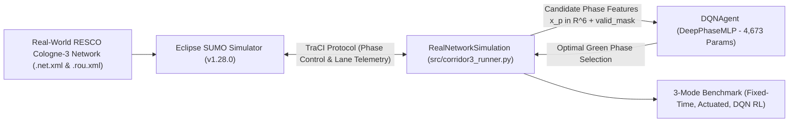

# Simulation-Based Intelligent Traffic Management System Using Deep Reinforcement Learning

**Manisa Celal Bayar University — Department of Computer Engineering (Graduation Project)**

An adaptive urban traffic signal control framework built on **Eclipse SUMO** and **Python (TraCI)** that reduces vehicle waiting times, queue lengths, and $\text{CO}_2$ emissions using a **Deep Q-Network (DQN)** controller with acyclic smart phase skipping on real-world benchmark urban arterial corridors.

---

## 1. Architecture & Methodology



### Evaluated Control Modes (Cologne-3 Arterial Corridor: 3 Intersections)
1. **Fixed-Time (`FixedTimeController`):** Conventional static cycle length with rigid sequential phase order (Webster baseline).
2. **Traffic-Actuated (`ActuatedController`):** Classical gap-out and maximum-green sensor-actuated logic (NEMA TS2 baseline).
3. **Deep Q-Network (`DQNAgent` - Proposed):** Phase-Centric MLP (`DeepPhaseMLP`: `6 -> 64 -> 64 -> 1`, 4,673 parameters) with Experience Replay, Target Network, acyclic smart phase skipping, and minimum/maximum green safety constraints.

---

## 2. Experimental Benchmark Results (1800s Morning Peak Hour, seed=42)

Evaluated on the calibrated **RESCO Cologne-3** arterial network (Dürener Straße, Köln-Lindenthal):

| Control Mode | Avg Waiting Time | Avg Corridor Queue | Avg Travel Time | Total $\text{CO}_2$ Emissions | Improvement vs Fixed-Time |
| :--- | :---: | :---: | :---: | :---: | :---: |
| **1. Fixed-Time (Static)** | `33.09 s` | `18.34 veh` | `82.88 s` | `91.86 kg` | — (Baseline) |
| **2. Traffic-Actuated (Sensor-Based)** | `31.00 s` | `14.02 veh` | `83.17 s` | `82.80 kg` | **-6.3%** |
| **3. DQN RL (4-Phase Smart Phase Skipping)** | **`14.40 s`** | **`7.30 veh`** | **`62.77 s`** | **`54.80 kg`** | **-56.5% vs Fixed (-53.5% vs Actuated)** |

---

## 3. Repository Structure

```text
traffic-rl/
├── README.md                              # Project overview, methodology, and benchmark results
├── ARCHITECTURE.md                        # In-depth system architecture & dataflow analysis
├── RULES.md                               # System coding rules and safety invariants
├── PLAN.md                                # Project progress and roadmap towards final delivery
├── DATA_SOURCES.md                        # RESCO / TAPAS Cologne dataset citations & topology specs
├── requirements.txt                       # Python dependencies (python-docx, lxml, etc.)
│
├── 1_Mod_Sabit_Sureli_3Kavsak_Izle.bat    # Portable batch launcher: Fixed-Time in SUMO-GUI
├── 2_Mod_Sensorlu_Actuated_3Kavsak_Izle.bat # Portable batch launcher: Actuated in SUMO-GUI
├── 3_Mod_Akilli_RL_DQN_3Kavsak_Izle.bat   # Portable batch launcher: Trained DQN in SUMO-GUI
├── 4_Tum_Modlari_Hizli_Karsilastir_Tablo.bat # Headless 3-mode benchmark runner & comparison table
├── 5_Egitimi_Baslat_veya_Devam_Et.bat     # Checkpointed DQN training launcher
├── 6_Egitimi_Sifirla_Bastan_Baslat.bat    # Clean-slate DQN training launcher
│
├── src/                                   # Source code
│   ├── rl_agent.py                        # DeepPhaseMLP (6->64->64->1) & DQNAgent
│   ├── corridor3_runner.py                # RealNetworkSimulation, 3-mode benchmark, training loop
│   └── generate_charts.py                 # Vector SVG chart renderer (learning_curve, comparison)
│
├── nets/                                  # Real-world calibrated SUMO networks
│   ├── cologne3/                          # NeurIPS 2021 RESCO 3-junction corridor (Nodes 359566, 360086, 360082)
│   └── cologne1/                          # RESCO single intersection (Node 357187)
│
├── models/                                # Trained neural network weights
│   ├── dqn_resco_cologne.json             # 50-episode trained best neural network weights
│   └── training_checkpoint.json           # Full resume checkpoint
│
├── results/                               # Benchmark logs, summary CSVs, and vector SVG charts
│   ├── cologne3_corridor_summary.csv      # Official 3-mode benchmark metrics
│   ├── training_log.csv                   # 50-episode training telemetry log
│   ├── cologne3_comparison.svg            # 3-mode comparison bar chart
│   └── learning_curve.svg                 # 50-episode DQN convergence chart
│
└── docs/                                  # Academic reports and presentation briefs
    ├── MCBU_Midterm_Report.docx           # Official MCBU Midterm Report (Word)
    ├── MCBU_Midterm_Report.md             # Official MCBU Midterm Report (Markdown)
    ├── Executive_Summary.pdf              # 2-page executive summary & technical brief (PDF)
    ├── Executive_Summary.docx             # 2-page executive summary & technical brief (Word)
    ├── Executive_Summary.md               # 2-page executive summary & technical brief (Markdown)
    ├── generate_midterm_report.py         # Script to compile MCBU Midterm Report
    └── generate_brief_pdf.py              # Script to compile Executive Summary
```

---

## 4. Quick Start

### 1. Run 3-Mode Benchmark Comparison (Headless)
Double-click `4_Tum_Modlari_Hizli_Karsilastir_Tablo.bat` or run:
```powershell
python src/corridor3_runner.py compare
```

### 2. Watch Live Interactive SUMO-GUI Demonstration
Double-click `3_Mod_Akilli_RL_DQN_3Kavsak_Izle.bat` or run:
```powershell
python src/corridor3_runner.py dqn
```

### 3. Checkpointed Training
Double-click `5_Egitimi_Baslat_veya_Devam_Et.bat` or run:
```powershell
python src/corridor3_runner.py train
```
