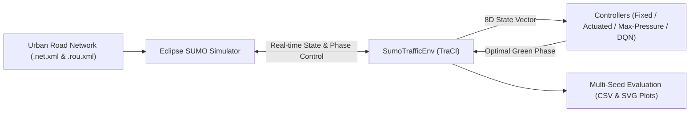

# Simulation-Based Intelligent Traffic Management System Using Deep Reinforcement Learning

**Manisa Celal Bayar University — Department of Computer Engineering (Graduation Project)**

An adaptive urban traffic signal control framework built on **Eclipse SUMO** and **Python (TraCI)** that reduces vehicle waiting times, queue lengths, and $CO_2$ emissions using **Deep Q-Network (DQN)** Reinforcement Learning and **Max-Pressure** control on benchmark urban road networks.

---

## Architecture & Methodology



### Controllers Implemented
1. **Fixed-Time (`FixedTimeController`):** Conventional static cycle length with fixed green split.
2. **Traffic-Actuated (`ActuatedController`):** Classical gap-out and maximum-green sensor-actuated logic.
3. **Max-Pressure (`MaxPressureController`):** Decentralized queue-pressure balancing algorithm (Varaiya, 2013).
4. **Deep Q-Network (`DQNAgent` - Proposed):** 2-layer MLP Q-Network with Experience Replay, Target Network synchronization, and safety constraints (`min_green = 10s`, `max_green = 60s`, `yellow_time = 3s`).

---

## Repository Structure

```text
traffic-rl/
├── README.md
├── requirements.txt
├── run_gui_demo.bat              # One-click live SUMO-GUI demo with trained DQN agent
├── nets/
│   └── cologne1/                 # Calibrated multi-regime urban arterial intersection
├── src/
│   ├── build_networks.py         # Compiles SUMO networks (.net.xml) and demand (.rou.xml)
│   ├── env.py                    # Gymnasium-style SUMO TraCI RL environment
│   ├── baselines.py              # Fixed-Time, Actuated, and Max-Pressure controllers
│   ├── rl_agent.py               # Deep Q-Network (DQN) agent & replay buffer
│   ├── evaluate.py               # Training & 5-seed evaluation benchmark pipeline
│   └── demo_gui.py               # Interactive SUMO-GUI visual runner
├── models/
│   └── dqn_cologne1.json         # Trained DQN model weights
├── results/
│   ├── benchmark_summary.csv     # Aggregated Mean ± SD metrics across 5 random seeds
│   ├── benchmark_comparison.svg  # Vector bar chart of controller performance
│   └── training_log.csv          # Episode-by-episode DQN training progression
└── docs/                         # Graduation Project Midterm Report & UML models
```

---

## Quick Start

### 1. Build Road Network
```powershell
python src/build_networks.py
```

### 2. Train DQN Agent & Run 5-Seed Benchmark Evaluation
```powershell
python src/evaluate.py
```

### 3. Watch Live Visual Demo in SUMO-GUI
Double-click `run_gui_demo.bat` or run:
```powershell
python src/demo_gui.py dqn
```
