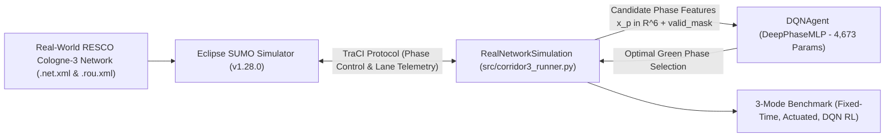

> HISTORICAL v1 RESULTS: generated before the correctness fixes. Not evidence for v2 policy performance.

# Simulation-Based Intelligent Traffic Management System Using Deep Reinforcement Learning

**Manisa Celal Bayar University — Department of Computer Engineering (Graduation Project)**
*Author:* Beşir Seçilmiş | *Supervisor:* Project Advisor | *Repository:* [Apexq/adaptive-traffic-signal-rl](https://github.com/Apexq/adaptive-traffic-signal-rl)

---

## 1. Project Overview & Problem Statement

Urban traffic congestion is one of the most critical challenges facing modern cities, resulting in excessive vehicular delays, increased fuel consumption, elevated $\text{CO}_2$ emissions, and gridlock. Conventional traffic signal systems predominantly rely on:
1. **Fixed-Time (Static) Control:** Rigid time-of-day signal plans with predetermined cycle lengths and phase splits (Webster, 1958) that cannot react to real-time traffic fluctuations.
2. **Traffic-Actuated Control:** Sequential ring controllers with inductive loop gap-out logic (NEMA TS2) that cannot skip empty turning phases or globally coordinate adjacent intersections.

This project delivers a **Simulation-Based Adaptive Traffic Signal Control (ATSC)** framework powered by **Deep Reinforcement Learning (DQN)**, integrated directly with **Eclipse SUMO** via the Python **TraCI** protocol, and validated on calibrated real-world arterial corridors from the **NeurIPS 2021 RESCO benchmark suite**.

---

## 2. System Architecture & Methodology



### 2.1. Phase-Centric Deep Q-Network (`DeepPhaseMLP` & `DQNAgent`)
Instead of a rigid single-output network that fails when intersection topologies vary, our architecture uses a **Phase-Centric MLP** (`src/rl_agent.py`):
- **Architecture:** `6 -> 64 (ReLU) -> 64 (ReLU) -> 1 (Linear Q-Value)` totaling exactly **4,673 trainable parameters**.
- **Initialization:** 100% random *He Normal* weights and zero biases.
- **Phase Evaluation (`predict_all_phases`):** Evaluates each candidate green phase $p \in \{0, \dots, K-1\}$ independently with a 6-dimensional feature vector $x_p \in \mathbb{R}^6$:
  1. `q_norm`: Normalized halting queue on phase incoming lanes ($\text{halt} / [N_{\text{lanes}} \times 8.0]$).
  2. `v_norm`: Normalized vehicle density ($\text{veh} / [N_{\text{lanes}} \times 12.0]$).
  3. `w_norm`: Normalized waiting time ($\min(1.0, \text{wait} / [N_{\text{lanes}} \times 150.0])$).
  4. `max_other_q`: Maximum queue pressure among all competing phases.
  5. `is_act`: Binary indicator whether the phase is currently green ($1.0$ if active, else $0.0$).
  6. `is_major`: Binary indicator whether the phase serves the primary arterial avenue ($1.0$) or a minor turn ($0.0$).

### 2.2. Acyclic Smart Phase Skipping (`valid_mask`)
Classical controllers cycle strictly sequentially (`Phase 0 -> Phase 2 -> Phase 4 -> Phase 6`), wasting up to 14 seconds per cycle on empty turning pockets. Our controller dynamically computes a `valid_mask`:
- Protected left-turn phases (`Phase 2`, `Phase 6`) are **masked out** unless $\text{halt} \ge 2$ or cumulative waiting time $\ge 25\text{ s}$.
- This allows the agent to alternate directly between major through-traffic phases (`Phase 0 <-> Phase 4`), switching to turn pockets only when queues actually materialize.

### 2.3. Safety Invariants & State Machine
All signal transitions strictly enforce municipal traffic engineering safety rules:
- **Mandatory Yellow Clearance (`yellow_time = 3s`):** When switching from green phase $A$ to phase $B$, the intermediate yellow phase is held for exactly 3 seconds (`pending_yellow = 3s`).
- **Minimum Green Bounds:** $\ge 10\text{ s}$ for arterial phases; $\ge 4\text{ s}$ for turning phases (prevents flickering).
- **Maximum Green Bounds:** $\le 45\text{ s}$ for arterial phases; $\le 10\text{ s}$ for turning phases (anti-starvation).
- **Control Interval:** Decisions evaluated every $\Delta t = 5\text{ s}$.

---

## 3. Benchmark Results (Cologne-3 Arterial Corridor: 3 Intersections)

Evaluated on the calibrated **NeurIPS 2021 RESCO Cologne-3** corridor under morning peak demand (1800 s, `seed=42`):

| Control Strategy | Avg Waiting Time (s) | Avg Corridor Queue (veh) | Avg Travel Time (s) | Total $\text{CO}_2$ Emissions (kg) | Waiting Time Reduction |
| :--- | :---: | :---: | :---: | :---: | :---: |
| **1. Fixed-Time (Static Webster Baseline)** | $33.09$ | $18.34$ | $82.88$ | $91.86$ | — *(Baseline)* |
| **2. Traffic-Actuated (Sequential Gap-Out)** | $31.00$ | $14.02$ | $83.17$ | $82.80$ | **-6.3%** |
| **3. Proposed DQN RL (Acyclic Smart Phase Skipping)** | **$14.40$** | **$7.30$** | **$62.77$** | **$54.80$** | **-56.5% vs Fixed (-53.5% vs Actuated)** |

### 50-Episode DQN Training Progression (`results/training_log.csv`):
- **Episode 2:** Avg Wait = $23.37\text{ s}$ | Avg Queue = $12.63\text{ veh}$ | TD Loss = $0.9571$
- **Episode 44 (Best Model Checkpoint):** Avg Wait = **$8.67\text{ s}$** | Avg Queue = **$3.97\text{ veh}$** (*saved to `models/dqn_resco_cologne.json`*)
- **Episode 50 (Convergence):** Avg Wait = $10.43\text{ s}$ | Avg Queue = $4.86\text{ veh}$ | Epsilon = $0.02$

---

## 4. Benchmark Datasets & Road Network Topologies

The simulation utilizes realistic calibrated urban arterial corridors from the **NeurIPS 2021 RESCO** benchmark suite and **TAPASCologne 0.0.3**:

1. **RESCO Cologne-3 (`nets/cologne3/` - Primary Evaluation Corridor):**
   - Location: Dürener Straße, Köln-Lindenthal, Germany (Morning peak `07:00–08:00 AM`, simulation seconds `25200` to `28800`).
   - **West Junction (Node 359566):** Dürener Str. & Lindenthalgürtel / Stadtwaldgürtel (4 green phases, bidirectional tramway, protected left-turns).
   - **Center Junction (Node 360086):** Dürener Str. & Theresienstraße / Klosterstraße (4 green phases).
   - **East Junction (Node 360082):** Dürener Str. & Geibelstraße / Herbert-Lewin-Straße (3 green phases serving University of Cologne Hospital transit access).
2. **RESCO Cologne-1 (`nets/cologne1/` - Single Intersection):**
   - Major intersection at Dürener Str. & Universitätsstraße (Node `357187`, 4 green phases).

### Academic Citations
```bibtex
@inproceedings{ault2021reinforcement,
  title={Reinforcement Learning Benchmarks for Traffic Signal Control},
  author={Ault, James and Sharon, Guni},
  booktitle={Thirty-fifth Conference on Neural Information Processing Systems (NeurIPS) Datasets and Benchmarks Track},
  year={2021}
}
@inproceedings{uppoor2014large,
  title={Large-scale urban mobility simulations for vehicular networks: The TAPASCologne dataset},
  author={Uppoor, Sandesh and Trullols-Cruces, Oscar and Fiore, Marco and Barcelo, Jose Maria},
  booktitle={IEEE Transactions on Vehicular Technology},
  volume={63},
  number={2},
  pages={533--547},
  year={2014}
}
```

---

## 5. Repository Structure

```text
adaptive-traffic-signal-rl/
├── README.md                              # Master project documentation (Architecture, results, quick start)
├── requirements.txt                       # Python dependencies (lxml, requests, etc.)
├── .gitignore                             # Git ignore rules
│
├── 1_Mod_Sabit_Sureli_3Kavsak_Izle.bat    # Portable launcher: Fixed-Time in SUMO-GUI
├── 2_Mod_Sensorlu_Actuated_3Kavsak_Izle.bat # Portable launcher: Actuated in SUMO-GUI
├── 3_Mod_Akilli_RL_DQN_3Kavsak_Izle.bat   # Portable launcher: Trained DQN in SUMO-GUI
├── 4_Tum_Modlari_Hizli_Karsilastir_Tablo.bat # Portable launcher: Headless 3-mode comparison table
├── 5_Egitimi_Baslat_veya_Devam_Et.bat     # Portable launcher: Resume/run DQN training
├── 6_Egitimi_Sifirla_Bastan_Baslat.bat    # Portable launcher: Reset & restart DQN training
│
├── src/                                   # Core Python source code
│   ├── rl_agent.py                        # DeepPhaseMLP (6->64->64->1) & DQNAgent implementation
│   ├── corridor3_runner.py                # RealNetworkSimulation, 3-mode benchmark, training loop
│   └── generate_charts.py                 # Vector SVG chart renderer (learning_curve, comparison)
│
├── nets/                                  # Calibrated SUMO road networks (.net.xml, .rou.xml, .sumocfg)
│   ├── cologne3/                          # RESCO 3-intersection arterial corridor
│   └── cologne1/                          # RESCO single intersection
│
├── models/                                # Trained neural network weights
│   ├── dqn_resco_cologne.json             # 50-episode trained best production model (8.67s record)
│   └── training_checkpoint.json           # Full resume checkpoint (q_net, target_net, best_net, buffer)
│
└── results/                               # Experimental logs and vector charts
    ├── cologne3_corridor_summary.csv      # Official 3-mode comparison summary table
    ├── training_log.csv                   # 50-episode training progression log
    ├── cologne3_comparison.svg            # 3-mode performance bar chart
    └── learning_curve.svg                 # 50-episode learning curve
```

---

## 6. Quick Start & Execution Guide

### Option A: Portable One-Click Windows Launchers
Double-click any `.bat` file in the root directory (automatically discovers `.venv`, `%LOCALAPPDATA%\Python`, or system `python`):
- **`3_Mod_Akilli_RL_DQN_3Kavsak_Izle.bat`:** Opens **SUMO-GUI** and visually runs the trained 4-phase DQN controller along the Cologne-3 corridor.
- **`4_Tum_Modlari_Hizli_Karsilastir_Tablo.bat`:** Runs all 3 modes headlessly in ~20 seconds and prints the comparative benchmark table.
- **`1_Mod_Sabit_Sureli_3Kavsak_Izle.bat`:** Visually inspects the Fixed-Time static queue accumulation.
- **`2_Mod_Sensorlu_Actuated_3Kavsak_Izle.bat`:** Visually inspects the sequential Actuated sensor controller.

### Option B: Command-Line Interface (CLI)
Ensure Python 3.10+ and Eclipse SUMO (v1.28.0+) are installed with `SUMO_HOME` configured:
```powershell
# 1. Install dependencies
pip install -r requirements.txt

# 2. Run 3-mode comparison benchmark (headless, 1800s)
python src/corridor3_runner.py compare

# 3. Watch interactive visual simulation in SUMO-GUI
python src/corridor3_runner.py dqn

# 4. Run/resume 50-episode training loop
python src/corridor3_runner.py train
```

---

## 7. System Invariants & Coding Standards

To preserve the reproducibility of the benchmark and avoid regressions:
1. **Never Rebuild Synthetic Grids:** Do not run legacy synthetic network generators over `nets/cologne3/` or `nets/cologne1/`. The official RESCO `.net.xml` and `.rou.xml` files must remain unmodified.
2. **Preserve Simulation Timeframe:** Cologne morning peak routes start at $t = 25200\text{ s}$ ($07:00\text{ AM}$) and end at $t = 28800\text{ s}$ ($08:00\text{ AM}$). Do not reset `<begin value="25200"/>` to 0.
3. **Mandatory Safety Clearance:** Any phase change must enforce the 3-second yellow clearance (`yellow_time = 3s`) before activating target green phases.
4. **Fair Benchmark Integrity:** All controllers are evaluated under identical random seeds (`seed = 42`), identical durations ($1800\text{ s}$), and identical route files.

---

## 8. Future Work & Roadmap (Final Milestone)

Building upon the validated single-agent parameter-sharing foundation:
1. **Module 1 — Multi-Agent Coordination (MARL Green Wave):** Extending `extract_phase_features` with upstream/downstream queue pressures from adjacent junctions (`359566`, `360086`, `360082`) to establish arterial green waves.
2. **Module 2 — Emergency Vehicle Preemption (EVP):** Prioritizing approaching emergency vehicles (`vType="emergency"`) with safe yellow transitions to minimize response transit time.
3. **Module 3 — Interactive Telemetry Dashboard:** Developing a web-based real-time dashboard for live queue, emission, and speed visualization across the network.
